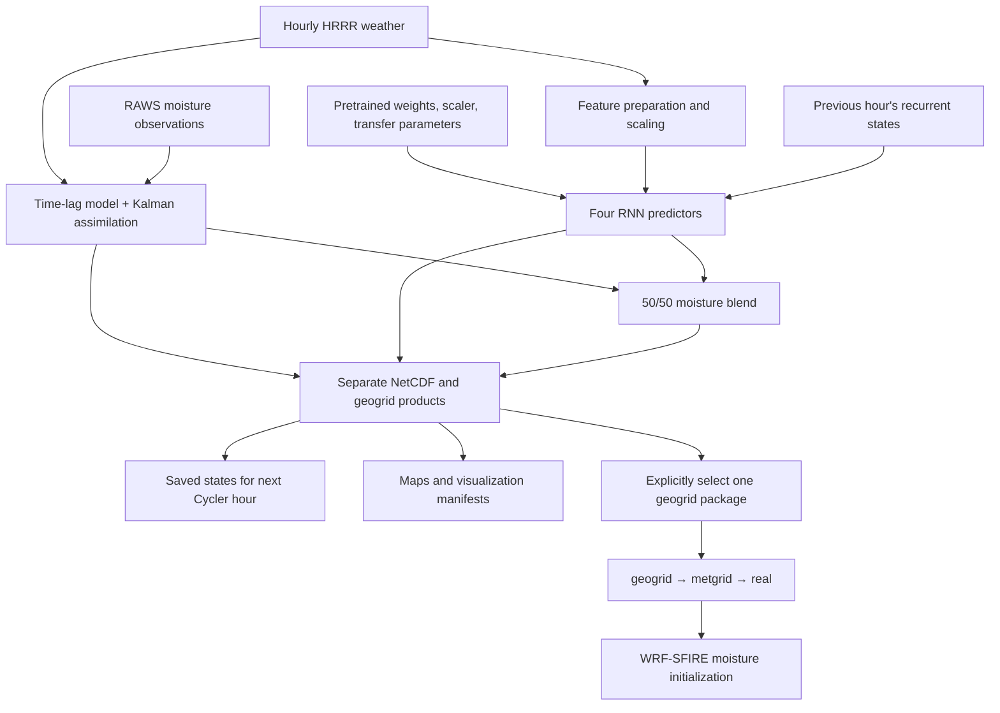

**Jonathon integrated the RNN into wrfxpy's hourly fuel-moisture Cycler. It runs alongside FMDA and produces separate RNN and blended moisture products. The connection to WRF-SFIRE is through exported initialization data; I found no RNN execution inside the inspected WRF-SFIRE code.**

I checked our `wrfxpy-v3.2` branch, Jonathon's operational configuration, and the WRF-SFIRE checkout referenced by his configuration.



**The Python interface and hourly calculation**

wrfxpy imports the installed `ml_fmda` package. Its [`RNNMoistureModel`](/data002/projects/dshield/wrfxpy-v3.2/src/fmda/fuel_moisture_rnn.py:39) subclasses `TimeWarpedFuelClassPredictors` and adds grid reshaping, NetCDF persistence, and geogrid/WPS exports.

At process startup, the Cycler loads:

- `params.yaml`: network architecture and ordered input features.
- `median_seed.csv`: selects the trained realization.
- `seed_<seed>/rnn.weights.h5` and `scaler.joblib`.
- `all_seeds_summary.csv`: time-warp parameters for FM1, FM100, and FM1000.

FM10 uses the pretrained source model. The other three predictors copy its weights and modify LSTM gate biases using the transfer parameters. **There is no model training in the hourly Cycler.**

For each grid cell and hour, the operational feature list comprises drying/wetting equilibria, humidity, temperature, solar radiation, wind, elevation, longitude, latitude, logarithmic rain, and cyclic hour/day features. wrfxpy converts equilibria to percent, applies the saved scaler, and supplies an array shaped approximately:

```text
[number of grid cells, 1 hourly step, number of features]
```

RNN predictions are converted from percent back to fractional moisture. The four classes are FM1, FM10, FM100, and FM1000. See [feature preparation](/data002/projects/dshield/wrfxpy-v3.2/src/hrrr_cycler.py:643).

The two models evolve separately:

- FMDA advances its physical model and assimilates available FM10 observations during analysis.
- RNN advances its recurrent state using weather inputs. It does not receive that hour's Kalman correction.
- The blend is calculated afterward: `0.5 * FMDA + 0.5 * RNN`. It retains FMDA's two equilibrium corrections, `dE` and `dS`.
- The next hour resumes FMDA and RNN separately. The blend is not fed back.

**Timing and persistence**

| Operation | Timing or frequency |
|---|---|
| Jonathon's supplied cron | Submits `hrrr_cycler.sh a` once per wall-clock hour. This runs moisture analysis, not WRF-SFIRE. |
| Analysis timestamp | Calculated in UTC as `floor_to_hour(now - 59 minutes)`. At an on-time hourly launch, this targets the preceding hour. |
| Model advancement | One-hour steps: FMDA uses `dt=3600`; RNN processes one hourly weather sample. |
| State continuation | Loads the previous hour's FMDA NetCDF and RNN recurrent states. Missing state can trigger lookback or cold initialization. |
| His `lookback_length=0` | Does not force a reset every hour: existing previous-hour files are still loaded. It prevents recursive reconstruction of missing earlier hours. |
| Forecast mode, `f` | First produces analysis, then advances hourly with HRRR forecast weather and no future observation assimilation. His quoted cron uses `a`. |
| Historical interval mode | Processes each hour from `from_utc` through `to_utc`, inclusive. |
| Output | Writes model products and generates visualization products for each computed hour. |

The forecast defaults are `period_hours=6` for HRRR initialization-cycle alignment and `forecast_length=48` for its horizon. These do not change the one-hour moisture step.

Each analysis hour has a directory such as:

```text
<workspace>/S-CONUS/YYYYMM/fmda-S-CONUS-YYYYMMDD-HH/
```

It contains separate `fmda-...`, `rnn-...`, and `blend-...` products; forecasts append `-fNN`.

| Product | Saved contents |
|---|---|
| FMDA NetCDF | Moisture, `dE/dS`, covariance, meteorological diagnostics. |
| RNN NetCDF | Four moisture predictions, hidden/cell states, model metadata. With the supplied 32-unit model, recurrent states have shape `[ny,nx,4,2,32]`. |
| Blend NetCDF | Four blended moisture values plus FMDA's `dE/dS`; no blended covariance. |
| Geogrid packages | Moisture planes plus longitude/latitude tracer planes. FMDA/blend also export `FMEP`; RNN exports flattened `RNN_STATES`. |

Completion currently means **all three NetCDF files exist**. It does not verify geogrid completeness or scientific validity. The Cycler uses files for continuation, not the forecast workflow's `job.json`.

**The WRF-SFIRE interface and its limits**

A forecast job selects a package through:

```json
"fmda_geogrid_path": "/path/to/selected-product.geo"
```

The existing [`fmda_add_to_geogrid`](/data002/projects/dshield/wrfxpy-v3.2/src/forecast.py:667) reads its `index.json` and `geogrid_tbl.json`, installs the dataset entries into the run's `GEOGRID.TBL`, and checks geographical coverage using the companion region coordinate NetCDF.

This allows selection of an FMDA, RNN, or blend package by path. There is no automatic “choose RNN” control or automatic matching of its timestamp to the fire simulation start. The selected data enter during preprocessing; the code does not continuously feed new Cycler products into a running fire simulation.

There are three important qualifications:

1. **No RNN continuation in WRF was found.** Jonathon's configured WRF-SFIRE checkout, `9801186f3`, contains the conventional moisture model but no `RNN_STATES` registration or RNN inference implementation. Exporting recurrent states prepares a possible interface; it does not implement its consumer.

2. **Current wrfxpy initialization selects only three input classes.** When `fmda_geogrid_path` is present, [forecast.py](/data002/projects/dshield/wrfxpy-v3.2/src/forecast.py:968) sets the first three classes to initialize from input, the fourth from equilibrium, and later classes from prescribed fuel moisture. Thus exporting FM1000 does not ensure that WRF uses its value.

3. **WPS intermediate output is implemented but disabled in the Cycler.** The `to_wps_format` calls are commented out in this version. NetCDF and geogrid output remain active.

Inside WRF-SFIRE, the existing namelist controls are separate from Cycler timing:

| WRF control | Meaning |
|---|---|
| `fmoist_run` | Enable the conventional moisture model on the atmospheric grid. |
| `fmoist_interp` | Map class moisture to fuels on the fire grid. |
| `fmoist_freq > 0` | Advance moisture every specified number of atmospheric steps. |
| `fmoist_freq = 0`, `fmoist_dt` | Advance by a time interval; the registry default is 600 seconds. |
| `fmc_gc_initialization` in `namelist.fire` | Choose input, prescribed moisture, or equilibrium initialization for each class. |

Those controls determine what happens after initialization. The Cycler's hourly frequency does not determine WRF's internal moisture frequency.

**JSON controls and actual operational settings**

| File | Relevant items |
|---|---|
| **New:** `etc/rnn_cycler.json` | `rnn_model_path`, `transfer_path`. These point to pretrained assets. |
| `etc/fmda_cycler.json` | `workspace_path`, `regions.<name>.code`, `bbox`, `lookback_length`; optional `forecast_length`, `period_hours`. |
| `etc/fmda_interval.json` | `from_utc`, `to_utc`, `fmda_conf_path` for historical hourly processing. |
| `etc/conf.json` | Installation paths and system settings; optional `shuttle_remote_host` and related settings enable publication of visualization products. |
| `etc/tokens.json` | `mesowest` credential for observation access. |
| Forecast job JSON | `fmda_geogrid_path` selects the initialization package; ordinary run timing and namelist paths control the fire simulation. |
| Generated package JSON | `index.json` describes geospatial datasets; `geogrid_tbl.json` supplies WPS table entries. These are metadata, not workflow state. |

Jonathon's operational configuration specifies:

- Region **S-CONUS**, bounding box `[23, -125, 38, -75]`.
- `lookback_length: 0`.
- Output root `/storage/math/NSF1/hirschij/wrfxpy_fmda_outputs/dshield_fmda_rnn`.
- Model assets beneath `/storage/math/NSF1/hirschij/FMDA/models/_OPERATIONAL_MODEL_/fm_transfer`.

The blend weights are hardcoded. There is no JSON switch enabling/disabling the RNN in this Cycler. Our `wrfxpy-v3.2` checkout currently lacks local `etc/rnn_cycler.json` and `etc/conf.json`, so it is not configured identically to his operational clone.

One timing issue found during inspection: forecast hour/day features are calculated from the base `cycle`, without adding `fcst_hour`. That needs checking before relying on RNN forecast-mode results; it does not affect the quoted analysis-mode cron in the same way.

**Documentation identified**

- [docs/rnn_integration.md](/data002/projects/dshield/wrfxpy-v3.2/docs/rnn_integration.md): Jonathon's main installation and operating guide, including dependencies, pretrained assets, configuration, tests, and output names. Some details lag the code: it names an earlier branch and lists WPS intermediate products whose writes are now disabled.
- [ml_fmda/docs/operational.md](/data002/projects/dshield/ml_fmda/docs/operational.md): distinguishes training, hindcasts, operational forecasts, and simulation initialization.
- [notes/rnn-validation-20261019.txt](/data002/projects/dshield/wrfxpy-v3.2/notes/rnn-validation-20261019.txt): test evidence and limitations. Its two remaining failures were subsequently addressed by `e861994` and `5e0b807`; the note remains a historical record.
- [docs/source/fmda.rst](/data002/projects/dshield/wrfxpy-v3.2/docs/source/fmda.rst): older FMDA documentation, principally observation assimilation into WRF files.
- [notes/wrfxpy-history.md](/data002/projects/dshield/wrfxpy-v3.2/notes/wrfxpy-history.md): our history review.

I found documentation and implementation for **RNN operation within the Cycler and export toward WPS**, but no documented, demonstrated end-to-end continuation of the RNN inside WRF-SFIRE.

The **blend provides a third fuel-moisture estimate** by averaging FMDA and RNN predictions:

```text
blended moisture = 0.5 × FMDA moisture + 0.5 × RNN moisture
```

It is computed separately for the 1-, 10-, 100-, and 1000-hour classes, after FMDA assimilates observations. Its intended role is to combine the observation-corrected physical model with the learned predictor, for comparison, mapping, or fire-model initialization.

It **does not couple their evolution**: the next hour still advances FMDA and RNN independently. The blend is an output product.

Two scientific choices remain significant:

- The fixed 50/50 weighting has no demonstrated optimality in the code reviewed.
- It retains FMDA's equilibrium corrections (`dE`, `dS`) despite changing the moisture values. Jonathon explicitly marks the credibility of that choice as a TODO.

The implementation therefore supplies a candidate combined estimate; it does not establish that the blend is more accurate than either model alone.

There are two kinds of correction:

1. **The assimilation correction to moisture is already included in FMDA's prediction.** The blend averages that corrected value with the RNN prediction:
   ```text
   m_blend = 0.5 * m_FMDA_after_assimilation + 0.5 * m_RNN
   ```
   Holding the RNN fixed, an assimilation change of `Δm` therefore changes the blend by `0.5 * Δm`.

2. **The extended-state corrections are copied unchanged from FMDA:**
   ```text
   dE_blend = dE_FMDA
   dS_blend = dS_FMDA
   ```
   `dE` adjusts drying/wetting equilibrium; `dS` adjusts rain saturation equilibrium. They are exported as `FMEP`, without averaging or halving.

They are **not added again to the blended moisture**. They accompany it for possible subsequent physical-model evolution. The Cycler itself does not advance the blend, and Jonathon's TODO questions whether retaining the full corrections with averaged moisture is scientifically appropriate.
